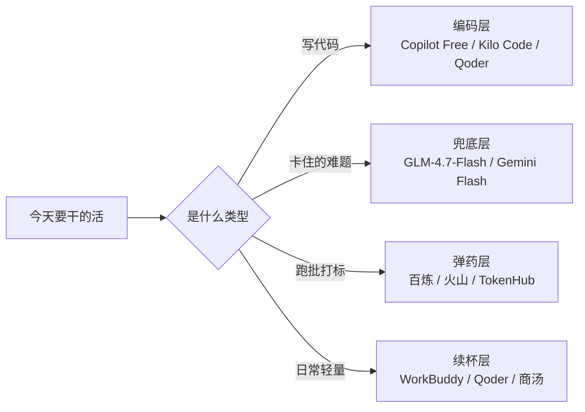
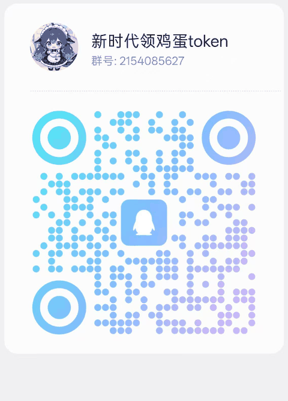

# 全网免费 AI API 额度雷达 · Free AI Token Radar


> 这不是又一份「2000 万 Token 免费领」的清单。
> **每一条都带截止日、带出处、带可信度，过期了会自动被标出来。**

**免费 API**、免费 token、每日签到积分、Credits、白嫖算力——全都收在这一个仓库里，国内外分开列，每条标明还能领多久。

这类清单最大的问题不是不全，是**过期了还在传**。你照着半年前的文章去注册，页面早就 404；你不确定是自己的操作错了，还是活动没了，白折腾一小时。

所以这个仓库做三件事：

1. **收**：国内外能白拿的 AI 额度，包括 Token、积分、Credits、算力；
2. **标**：每条写清楚截止日、要不要实名、要不要绑卡、出处链接、可信度；
3. **查**：脚本按日期自动体检，把过期的、快过期的、久未复核的挑出来。

数据都在 [`data/providers.yaml`](data/providers.yaml)，README 的表格是脚本渲染的，不是手抄的。

> 💬 发现哪条已经领不到了、或者挖到新的免费额度，欢迎来 [**QQ 群 2154085627**](#-交流群) 一起交流——群里先更正，攒一批再回写数据。

---

## 🔍 网页版

**👉 在线版：[kaiserdadi.github.io/awesome-free-ai-token](https://kaiserdadi.github.io/awesome-free-ai-token/)**

不想看表格就打开这个，手机上也能用。

表格看长了眼睛累。仓库里还带了一个**单文件网页**（`site/index.html`），双击就能开，不联网、不装依赖：

- **国内 / 海外 分开**，默认落在国内，国内 37 家平台、海外 31 家（同一产品的多个入口只算 1 家）；
- 按**产品 × 形态**分组，同一个 AI 的网页版、客户端、API 摆在一起；
- 顶栏可按「领取方式 / 形态」筛选，勾「免实名」只看不用身份证的；
- 顶部自动列出 **21 天内截止**的条目，按剩余天数排序；
- 搜索框按 `/` 聚焦，支持搜产品名、模型名、额度数字。

网页和 README 共用 `data/providers.yaml` 这一份数据：

```bash
python3 scripts/build_site.py   # 数据改了，重生成 site/index.html
```

想在 GitHub Pages 上发布，`.github/workflows/pages.yml` 已经写好，仓库 Settings → Pages → Source 选 **GitHub Actions** 即可，之后每次 push 自动更新。

---

## 先看这个：现在最值得动手的 5 条

如果只花十分钟，按这个顺序来：

| # | 去哪 | 拿什么 | 为什么是它 |
|---|---|---|---|
| 1 | [国家超算互联网](https://www.scnet.cn) | 新客 1 亿词元，0.1 元秒杀 5000 万词元包，客户端旗舰模型不限量 | 国家级平台，额度最猛，**11-30 截止** |
| 2 | [智谱开放平台](https://open.bigmodel.cn) | 新客 2000 万 Token（永久）+ GLM-4.7-Flash 永久 0 元 | 注册三分钟搞定，长期兜底首选 |
| 3 | [Google AI Studio](https://aistudio.google.com) | 每天 1000–1500 请求，1M 上下文 | 不要信用卡，模型最新，海外最强免费档 |
| 4 | [火山引擎方舟](https://console.volcengine.com/ark) | 实名后每模型每天 200 万 Token 自动刷新 | 每日续杯，跑批不心疼 |
| 5 | [WorkBuddy](https://www.workbuddy.cn) | 每天 100 积分（连签 7 天再送 1000） | 桌面端点两下，一分钟的事 |

> 第 1 条是限时活动，第 5 条是每日续杯，性质完全不同。**限时的先领，续杯的设成每天顺手点。**

---

## 完整清单

<!-- AUTO:START 由 scripts/render.py 生成，不要手改这一段 -->

> 数据截至 **2026-11-09** ｜ 共 **66** 家平台、**108** 个入口（国内 37 家 / 77 个入口 · 海外 31 家 / 31 个入口） ｜ 每日/每月续杯 18 条 ｜ 限时活动 10 条（**4 条 14 天内到期或已过期**）

> 平台数按「家」算：同一个产品的 12 个签到入口只记 1 家；入口数才是表格行数。

| 分类 | 入口数 | 一句话 |
|---|---|---|
| 限时活动 | 10 | 抢时间，先领后看 |
| 每日续杯 | 18 | 攒出来的额度最耐用 |
| 注册一次性 | 32 | 一次给一大笔 |
| 长期免费模型 | 48 | 兜底，不依赖活动 |

### 限时活动

*有明确截止日，先领再说。按剩余天数从少到多排。*

| 平台 | 白拿什么 | 额度 | 到期 | 门槛 | 可信 |
|---|---|---|---|---|---|
| [魔芋 AI 双 11](https://moyu.cn) | 新客 1000 万 + 老号回归 5000 万 + 企业认证 1 亿 + 邀请拉满 1.6 亿 | 合计最高约 2.7 亿 | **2026-11-11（剩 2 天）** | 实名 | 低 |
| [WorkBuddy 限时专家体验任务](https://www.workbuddy.cn) | 召唤指定的限时专家并对话一次，领积分；其中腾讯轻量云专家额外送 1 个月轻量应用服务器 | 100 积分/个，另有实物或云资源 | **2026-11-15（剩 6 天）** | 无 | 中 |
| [WorkBuddy 混元 Hy4 限时免费](https://www.workbuddy.cn) | Hy4 preview 夜间窗口 0 倍率、不扣积分；Hy3 纯语言任务同样 0 积分 | 夜间窗口 0 倍率 | **2026-11-15（剩 6 天）** | 无 | 中 |
| [蚂蚁百灵 Ling-3.2-Flash](https://developer.ant-ling.com) | 上线前两周 API 全免费，兼容 OpenAI / Anthropic 双协议 | 期限内不限量 | **2026-11-19（剩 10 天）** | 实名 | 高 |
| [超算互联网客户端（SCNet 智能体客户端 / SClaw）](https://www.scnet.cn) | 双 11 期间客户端内旗舰模型词元不限量、AI 调用不受限；新用户注册另领 1 亿词元科学计算智能体额度 | 活动期内不限量 + 1 亿词元智能体额度 | 2026-11-30（剩 21 天） | 无 | 高 |
| [火山引擎 11.11 AI 智选](https://www.volcengine.com) | 实名后每个模型每天 200 万自动刷新，活动页标总可用 2000 万+/天 | 2000 万+/天（4 模型合计） | 2026-11-30（剩 21 天） | 实名 | 中 |
| [超算互联网 模型服务 · 0.1 元秒杀 5000 万词元包](https://www.scnet.cn/ui/mall/service/llm) | 0.1 元秒杀 5000 万词元包，原价十七八元 | 5000 万词元（0.1 元） | 2026-11-30（剩 21 天） | 实名 | 中 |
| [阶跃星辰 Step Plan](https://platform.stepfun.com) | 登录送 15 天 + 完成首次调用再送 15 天 + 每邀 1 人双方各 15 天（上限 3 人） | 最高 75 天（不拉人也有 30 天） | 未公布 | 实名 | 高 |
| [阶跃 stepaudio 音频模型限时免费](https://platform.stepfun.com) | stepaudio-3 系列音频多模态模型限时免费调用，CORS 完全开放 | 限时免费（不限量） | 长期 | 实名 | 低 |
| [CatPaw 猫爪（公测免费）](https://catpaw.meituan.com) | 公测期客户端完全免费，每日重置海量 Token，Ask / Agent 双模式 | 每日重置（Flash-Lite 额度很大） | 长期 | 无 | 低 |

### 每日 / 每月续杯

*签一次到、点一次领取，就能反复拿。适合当日常主力。*

| 平台 | 白拿什么 | 额度 | 到期 | 门槛 | 可信 |
|---|---|---|---|---|---|
| [WorkBuddy Buddy 加油站](https://www.workbuddy.cn) | 桌面客户端左下角头像 → Buddy 加油站 → 领取今日礼包；连签 7 天额外 1000 | 每天 100 积分（月约 3000） | 未公布 | 无 | 高 |
| [WorkBuddy 体验版月赠积分](https://www.workbuddy.cn) | 免费（体验版）账号每月自动发放基础积分，不用做任何操作 | 每月 500 积分 | 长期 | 无 | 高 |
| [WorkBuddy 派 Buddy 去旅行](https://www.workbuddy.cn) | 左下角头像 → 成长计划 → 派 Buddy 去旅行，点「派出去」，回来领积分与盲盒 | 每天 5~10 积分 + 盲盒 | 未公布 | 无 | 中 |
| [WorkBuddy 福利抽奖](https://www.workbuddy.cn) | 用连登送的抽奖次数在转盘抽奖，奖品为积分或周边 | 10 或 100 积分 | 未公布 | 无 | 中 |
| [Qoder 每日 100 Credits](https://qoder.com) | 每天 10:00 开放新一轮，桌面端用量面板礼物图标手动领 | 每天 100 Credits（30 天有效） | 未公布 | 无 | 高 |
| [豆包（电脑端签到）](https://www.doubao.com) | 电脑版左侧活动位或「我 → 免费额度」签到 | 每天约 200 额度（周一翻倍） | 未公布 | 实名 | 中 |
| [电信天翼 AI](https://teleai.com.cn) | 下载客户端手机号注册，每天 0 点重置 | 工作日 1.8 亿/天，周末 2 亿/天 | 未公布 | 实名 | 中 |
| [书生·端砚](https://discovery.intern-ai.org.cn) | 微信扫码登录，每月发放墨点，1 墨点最高抵 5000 万 Token | 每月 10 墨点（约 5 亿 Token） | 未公布 | 无 | 中 |
| [商汤日日新 SenseNova](https://platform.sensenova.cn/token-plan) | Token Plan 公测期整体免费，滚动窗口刷新，无需绑卡 | 5 小时 12 万积分 + 每周 120 万积分 | 未公布 | 实名 | 高 |
| [七牛云 Conatus 每日额度](https://www.qiniu.com/ai/models) | 完成认证后每天自动发放，0 点重置 | 每天 1 亿 Token | 2026-11-30（剩 21 天） | 实名 | 中 |
| [WorkBuddy 连续登录活跃地图](https://www.workbuddy.cn) | 连登满 7 / 14 / 28 天三个节点，分别兑换能量、积分、补登卡与抽奖次数 | 最高 150 积分/档 + 补登卡 | 未公布 | 无 | 中 |
| [魔搭社区 ModelScope 推理 API](https://modelscope.cn) | 绑定阿里云账号后每天免费调用额度 | 每天 2000 次调用 | 长期 | 实名 | 高 |
| [百度 AI Studio（算力）](https://aistudio.baidu.com) | 每天赠送算力点，可跑 V100/A100 环境 | 每天 8 算力点（约 16 V100 小时） | 长期 | 实名 | 高 |
| [腾讯 Cloud Studio（算力）](https://cloudstudio.net) | 标准版每月赠开发时长 + GPU 时长，预装 Ollama 与 DeepSeek | 每月 10000 分钟 + 10000 GPU 分钟（T4 16G） | 长期 | 实名 | 高 |
| [智谱 ZCode / AutoClaw 夜间包](https://z.ai) | 客户端左下角弹窗领取当日额度，23 点生效、次日 9 点过期 | 单日最高约 3 亿 Token（周末包口径 5 亿） | 未公布 | 实名 | 中 |
| [火山方舟协作奖励计划](https://console.volcengine.com/ark) | 调用指定模型并上报推理数据，次日返还等量免费 Token 包 | 每日单模型上限 500 万 Token | 未公布 | 实名 | 中 |
| [方舟 每日 200 万 Token](https://console.volcengine.com/ark) | 开通后每天发放 200 万 Token，按天重置，是目前国内日额度最大的一档 | 每天 200 万 Token | 长期 | 实名 | 低 |
| [xAI Grok API 🌐](https://x.ai/api) | 每月基础免费额度，同意数据用于训练可提到更高档 | $25/月（共享数据 $150/月） | 未公布 | 绑卡 | 低 |

### 注册 / 实名一次性

*开号就发，一辈子一次。国内优先，上手成本从低到高。*

| 平台 | 白拿什么 | 额度 | 到期 | 门槛 | 可信 |
|---|---|---|---|---|---|
| [智谱 GLM 新客赠额](https://maas-api.bigmodel.cn) | 手机号注册送 2000 万 Token 体验包，全系模型可用，另附 120 次图像与视频生成 | 2000 万 Token | 长期 | 实名 | 高 |
| [硅基流动 SiliconFlow](https://cloud.siliconflow.cn) | 新用户注册送额度券，另做新手任务可再加 | 2000 万 Token（约 14 元） | 长期 | 实名 | 高 |
| [七牛云 AI 推理](https://www.qiniu.com/ai/models) | 创建第一个 API Key 即激活资源包 | 300 万 Token（2 年有效） | 2028-12-31（剩 783 天） | 实名 | 高 |
| [Qoder 新用户试用 / 邀请](https://qoder.com/activities) | 新用户免费试用 2 周 Pro；邀请好友注册双方得 Credits | 试用期约 300 Credits；邀请奖励 50–1000 Credits 不等 | 未公布 | 无 | 高 |
| [Kimi 开放平台（月之暗面）](https://platform.moonshot.cn) | 新用户实名后发放代金券，抵扣 API 调用 | 15 元代金券 | 未公布 | 实名 | 高 |
| [DeepSeek 开放平台](https://platform.deepseek.com) | 新用户注册赠送 Token | 100 万 ~ 500 万 Token（30 天有效） | 未公布 | 实名 | 中 |
| [方舟 安心体验模式（防扣费）](https://www.volcengine.com/docs/82379/1465347) | 开启后调用只消耗免费额度，接近用完自动暂停服务，不会产生任何费用 | 防扣费开关（不额外给额度） | 长期 | 实名 | 高 |
| [智谱 GLM 邀好友](https://maas-api.bigmodel.cn) | 通过邀请链接注册，双方各得额外 Tokens，邀请人累计口径最高 2 亿 | 最高 2 亿 Token（累计口径） | 未公布 | 实名 | 中 |
| [阿里云百炼（DashScope）](https://bailian.console.aliyun.com) | 控制台首页「新手资源」手动领取，每个模型独立 100 万 | 约 7000 万 Token（累计） | 2026-12-31（剩 52 天） | 实名 | 高 |
| [火山引擎方舟（豆包）](https://console.volcengine.com/ark) | 新用户每个模型 50 万 Token 安心体验额度 | 每模型 50 万 Token | 长期 | 实名 | 高 |
| [腾讯云 TokenHub / 混元](https://cloud.tencent.com/product/tokenhub) | 新用户每个模型各领 100 万 Token 免费体验包 | 每模型 100 万 Token | 2026-12-31（剩 52 天） | 实名 | 高 |
| [WorkBuddy 成长计划任务中心](https://www.workbuddy.cn) | 头像 → 成长计划 → 任务，新手任务与体验任务，完成即得积分 | 单任务 100~300，一次性合计 1000+ | 未公布 | 无 | 高 |
| [WorkBuddy 关联账号一次性积分](https://www.workbuddy.cn) | 电脑端 设置 → 个人主页 → 前往管理中心，关联腾讯文档 / 腾讯会议 / ima / 腾讯网盘 | 100 积分 | 未公布 | 无 | 中 |
| [DeepSeek Harness 桌面端](https://www.deepseek.com) | 下载 Windows / macOS 安装包，首次登录送 6 元赠金，无需充值 | 6 元赠金（限量，到账后 7 天有效） | 未公布 | 实名 | 高 |
| [移动云 MoMA](https://ecloud.10086.cn) | 新用户控制台手动领取（限自营模型） | 2500 万 Tokens | 2026-12-31（剩 52 天） | 实名 | 中 |
| [小米 MiMo 开放平台](https://ai.xiaomi.com) | 新用户注册赠试用额度 | 未公开固定数值 | 未公布 | 实名 | 低 |
| [百炼 新客各模型 100 万 Token](https://bailian.console.aliyun.com) | 开通百炼后系统自动给每个模型发 100 万 Token，80 多个模型各自独立、互不共享，合计约 8000 万 | 每模型 100 万 Token（合计约 8000 万） | 长期 | 实名 | 高 |
| [方舟 每模型 50 万 Token 免费额度](https://console.volcengine.com/ark) | 每个模型开通即送 50 万 Token 免费推理额度，20 多个主力模型累加超过 2500 万 | 每模型 50 万 Token（累计 2500 万+） | 长期 | 实名 | 高 |
| [方舟 图像 / 语音 / 向量免费额度](https://www.volcengine.com/product/ark) | 生图 50~200 张、语音合成 5000 字符、声音复刻 10 个、流式语音识别 20 小时、embedding 50 万 Token、联网插件 2 万次/月 | 生图 50~200 张 + 语音 20 小时 + 联网 2 万次/月 | 长期 | 实名 | 高 |
| [千帆 每模型 100 万 Token](https://console.bce.baidu.com/qianfan/overview) | 开通后每个模型发 100 万 Token 免费额度，ERNIE-4.5 系列 90 天有效 | 每模型 100 万 Token | 长期 | 实名 | 中 |
| [星火 新客 Token 包](https://xinghuo.xfyun.cn) | 个人实名认证送 20 万 Token，企业认证送 100 万 Token | 20 万（个人）/ 100 万（企业） | 长期 | 实名 | 低 |
| [MiniMax 开放平台 15 元代金券](https://platform.minimaxi.com) | 注册自动赠送 15 元代金券，折合约 350 万~700 万 Token | 15 元（约 350 万~700 万 Token） | 长期 | 实名 | 中 |
| [百川 注册送 80 元代金券](https://platform.baichuan-ai.com) | 注册即送 80 元体验代金券，折合约 500 万 Token | 80 元（约 500 万 Token） | 长期 | 实名 | 中 |
| [超算互联网 模型服务 · 新客 1000 万 Token 包](https://www.scnet.cn/ui/mall/service/llm) | 活动期内注册的新账号可领 1000 万 Token 包，注册即到账，每个账号一次 | 1000 万 Token | 2026-12-31（剩 52 天） | 实名 | 高 |
| [WorkBuddy 邀约好友](https://www.workbuddy.cn) | 好友通过你的链接注册并完成首次对话得 50；7 天内累计用满 3 天再得 100；好友 30 天内首次订阅付费，双方各得 500 | 最高 650 积分/人 | 未公布 | 无 | 中 |
| [蛙池 AI 内测（送 2200 蛙蛙币）](https://digpool.cn) | 斗象科技 / 漏洞盒子出品的 AI 渗透 Agent，凭内测邀请码注册即送 2200 蛙蛙币，全功能体验 | 2200 蛙蛙币（约合 220 元），积分制 10 元 = 100 积分 | 未公布 | 无 | 高 |
| [腾讯混元 首次开通 100 万 Token](https://cloud.tencent.com/product/hunyuan) | 首次开通混元送 100 万 Token，10 款主力模型共享；Embedding 另送 100 万 | 100 万 Token + 100 万 Embedding | 长期 | 实名 | 高 |
| [WorkBuddy 社区投稿](https://cloud.tencent.com/developer) | 在腾讯云开发者社区发布 WorkBuddy 实操文章并带上指定标签，按稿件质量给奖励 | 普通稿 500，精选最高 3000 | 未公布 | 无 | 低 |
| [NVIDIA NIM (build.nvidia.com) 🌐](https://build.nvidia.com) | 邮箱注册后在 API Keys 页生成密钥，兼容 OpenAI 格式 | 1000 credits（约 40 RPM） | 未公布 | 无 | 高 |
| [OpenAI API 试用额度 🌐](https://platform.openai.com) | 新账号赠送 API 额度 | $5（3 个月有效） | 未公布 | 绑卡 | 中 |
| [Anthropic API 试用额度 🌐](https://console.anthropic.com) | 新账号赠送 API 额度 | 约 $5（14 天有效） | 未公布 | 绑卡 | 低 |
| [百炼 国际站（新加坡）免实名额度 🌐](https://www.alibabacloud.com/product/modelstudio) | 国际站在新加坡地域开通百炼，不需要实名就能领各模型新人免费额度 | 每模型 100 万 Token（90 天） | 长期 | 无 | 高 |

### 长期 0 元模型

*价目表上就是 0 元，不靠活动。最适合当兜底。*

| 平台 | 白拿什么 | 额度 | 到期 | 门槛 | 可信 |
|---|---|---|---|---|---|
| [智谱 GLM-Flash 免费档](https://bigmodel.cn/pricing?tab=api) | 价格页直接标 0 元，输入免费、输出免费、缓存也免费 | 不限量，受并发限制 | 长期 | 实名 | 高 |
| [硅基流动小模型免费档](https://cloud.siliconflow.cn) | 9B 参数以下模型长期免费不限量 | 无限量 | 长期 | 实名 | 高 |
| [百度智能云千帆](https://console.bce.baidu.com/qianfan) | ERNIE-Speed / Lite / Tiny 永久免费，QPS 50 | 无限量（QPS 50） | 长期 | 实名 | 高 |
| [讯飞星火 Spark Lite](https://xinghuo.xfyun.cn) | Spark Lite / X2.5-1.7B 长期免费，X2.5-4B 限时免费 | 无限量 | 长期 | 实名 | 中 |
| [WorkBuddy 网页版](https://www.workbuddy.cn) | 浏览器打开官网直接对话，不用安装 | 可用，但没有签到与成长计划 | 长期 | 无 | 高 |
| [豆包网页版](https://www.doubao.com) | 浏览器打开直接对话，部分功能免登录可试 | 不限量（有频率限制） | 长期 | 实名 | 中 |
| [Kimi 网页版](https://kimi.com) | 网页端直接对话，长上下文与联网搜索免费 | 不限量（有频率限制） | 长期 | 实名 | 中 |
| [DeepSeek 网页版](https://chat.deepseek.com) | 打开网页登录即可对话，深度思考与联网搜索默认可用 | 不限量（有频率限制） | 长期 | 实名 | 高 |
| [DeepSeek 手机 App](https://www.deepseek.com) | 应用商店搜索安装，登录即用，与网页版同一套额度 | 不限量（有频率限制） | 长期 | 实名 | 高 |
| [TRAE 国内版 免费档](https://www.trae.cn/pricing) | 字节的 AI 原生 IDE，免费档官方口径是「所有功能均可免费使用」，每月给 500 积分 | 每月 500 积分 + 2 个云端任务并发 | 长期 | 无 | 高 |
| [Qoder CN 个人社区版](https://docs.qoder.cn) | 阿里云原通义灵码，个人社区版免费，含补全、问答、多文件编辑与编程智能体 | 补全与问答不限次，编程智能体对话 50 轮次/月 | 长期 | 无 | 高 |
| [文心快码 个人标准版](https://comate.baidu.com) | 百度 AI 编程助手，个人标准版免费，注册另赠 10 元体验金 | 个人标准版免费 + ¥10 体验金 | 长期 | 无 | 中 |
| [CodeBuddy 体验版](https://copilot.tencent.com) | 腾讯 AI IDE，体验版每月 500 积分 + 不限次代码补全 | 每月 500 积分 + 无限补全 | 长期 | 无 | 中 |
| [CodeGeeX 免费版](https://codegeex.cn) | 智谱的开源编程助手，免费版给全功能，模型可自己本地部署 | 免费版全功能不限量 | 长期 | 无 | 中 |
| [通义千问 App / 网页版](https://www.tongyi.com) | 对话、联网搜索、文档解析、图片理解全部免费，不限次数（有频率限制） | 不限量（有频率限制） | 长期 | 无 | 高 |
| [腾讯元宝 App / 网页版](https://yuanbao.tencent.com) | 对话、AI 生图、AI 视频、AI 播客全部免费，注册即可用 | 不限量（有频率限制） | 长期 | 无 | 高 |
| [星火 Spark Lite 永久免费](https://xinghuo.xfyun.cn) | Spark Lite 模型永久免费，Token 总量不限，QPS 2 | 不限量（QPS 2） | 长期 | 无 | 中 |
| [海螺 AI App / 网页版](https://hailuoai.com) | 对话、AI 视频生成、语音克隆有免费额度，每日刷新 | 每日免费额度（视频按条数） | 长期 | 无 | 中 |
| [快手万擎 StreamLake](https://streamlake.com) | 编码模型输入输出全免费 | 无限量 | 未公布 | 实名 | 中 |
| [硅基流动 7 个永久 0 元模型](https://cloud.siliconflow.cn) | 7 个中小参数模型价格直接标 0，永久免费，不消耗赠送额度 | 不限量（受速率限制） | 长期 | 实名 | 中 |
| [混元 Lite 永久免费](https://cloud.tencent.com/product/hunyuan) | Hunyuan-Lite 价格标 0，永久免费，可用来兜底 | 不限量（受速率限制） | 长期 | 实名 | 中 |
| [千帆 ERNIE-Speed 永久免费](https://console.bce.baidu.com/qianfan/overview) | ERNIE-Speed / ERNIE-Lite 价格 0 元，永久免费，QPS 约 50 | 不限量（QPS 约 50） | 长期 | 实名 | 中 |
| [Google AI Studio / Gemini API 🌐](https://aistudio.google.com) | Flash / Flash-Lite 系列免费层，每天配额重置，无需信用卡 | 每天 1000–1500 请求，1M 上下文 | 长期 | 无 | 高 |
| [Groq Cloud 🌐](https://console.groq.com) | 免费层按模型给每日请求上限，邮箱注册即可 | 30 RPM，1000 请求/天，20 万 Token/天 | 长期 | 无 | 高 |
| [Cerebras Inference 🌐](https://cloud.cerebras.ai) | 免费层每天固定 Token 额度，无需信用卡 | 每天 100 万 Token（5 RPM，8K 上下文） | 长期 | 无 | 中 |
| [OpenRouter 🌐](https://openrouter.ai) | 带 :free 后缀的模型免费调用，一个 Key 通吃多家 | 20 RPM，50 请求/天（历史充值过 $10 升到 1000/天） | 长期 | 无 | 高 |
| [GitHub Models 🌐](https://github.com/marketplace/models) | 用 GitHub 账号直接调 GPT / Llama / Phi 等模型 | 10 RPM 起，50–150 请求/天 | 未公布 | 无 | 低 |
| [Cohere 🌐](https://dashboard.cohere.com) | 试用 Key，无需信用卡 | 每月 1000 次调用 | 长期 | 无 | 高 |
| [OpenCode Zen 🌐](https://opencode.ai) | 客户端自带若干免费模型，装完即可用，不需自备 Key | 免费模型不限量（有限速） | 未公布 | 无 | 中 |
| [Kilo Code 🌐](https://kilocode.ai) | 开源 AI 编程 Agent，内含十余个免费模型，不要 Key、不要卡 | 约 200 请求/小时 | 未公布 | 无 | 中 |
| [GitHub Copilot Free 🌐](https://github.com/features/copilot) | 个人免费档，含代码补全与 Chat | 每月 2000 次补全 + 50 次 Chat | 长期 | 无 | 高 |
| [Bolt.new 免费档 🌐](https://bolt.new/pricing) | StackBlitz 的浏览器内全栈 AI 建站，免费档每月 100 万 token（每日 30 万上限） | 每月 100 万 token，日限 30 万 | 长期 | 无 | 高 |
| [Lovable 免费档 🌐](https://lovable.dev/pricing) | 对话生成全栈 Web 应用，免费档每天 5 个 build credits（每月上限 30） | 5 credits/天，30/月 | 长期 | 无 | 高 |
| [Mistral La Plateforme 🌐](https://console.mistral.ai) | Experiment 免费档，限速可用全系模型 | 约 10 亿 Token/月（官方已不公布具体数值，看控制台） | 长期 | 无 | 中 |
| [Cloudflare Workers AI 🌐](https://developers.cloudflare.com/workers-ai/) | 免费套餐每天赠 Neurons，按模型换算成调用量 | 每天 10000 Neurons | 长期 | 无 | 高 |
| [Hugging Face Inference Providers 🌐](https://huggingface.co/docs/inference-providers) | 免费账户每月极小额度的推理额度，可路由数千个社区模型 | 约 $0.10/月 | 长期 | 无 | 高 |
| [TRAE 国际版 Free 🌐](https://www.trae.ai/pricing) | 免费档每月 5000 次补全 + 一笔一次性 AI 用量，只能走 Auto 模式 | 每月 5000 次补全 + 一次性用量额度 + 2 个云端任务 | 长期 | 无 | 高 |
| [Cursor Hobby 🌐](https://cursor.com/pricing) | 免费档含每月 2000 次补全 + 50 次慢速高级模型请求，Agent 与 Chat 都能用 | 每月 2000 次补全 + 50 次慢请求 | 长期 | 无 | 高 |
| [Devin Desktop Free 🌐](https://windsurf.com/pricing) | 免费档给轻量配额 + 不限次 Tab 补全，Cascade Agent 可用 | 每月 25 Cascade credits + 无限补全 | 长期 | 无 | 中 |
| [Kiro Free 🌐](https://kiro.dev/pricing) | AWS 的 spec 驱动 AI IDE，免费档每月 50 credits，新用户另送 500 | 每月 50 credits + 新用户 500 赠送 | 长期 | 无 | 高 |
| [Antigravity 免费预览 🌐](https://antigravity.google) | Google 的 Agent 开发平台（IDE + App + CLI），预览期免费，按周给配额，全部功能开放 | 每周配额（具体数字官方未公示） | 长期 | 无 | 高 |
| [Zed 免费版 🌐](https://zed.dev/pricing) | Rust 写的开源编辑器，本体免费，AI 每月 2000 次 edit prediction，也可自带 key 或外接 Claude Code / Codex | 每月 2000 次编辑预测 + 自带 key 不限 | 长期 | 无 | 中 |
| [Cline（开源，自带 Key） 🌐](https://cline.bot) | Apache-2.0 开源的 VS Code Agent 扩展，工具本身免费，模型用你自己的 key 或本地模型 | 工具免费无限制，只付模型钱 | 长期 | 无 | 高 |
| [Roo Code（开源，自带 Key） 🌐](https://roocode.com) | 开源 VS Code Agent 扩展（Cline 分支），免费，支持多角色模式与自定义规则 | 工具免费无限制 | 长期 | 无 | 高 |
| [v0 免费档 🌐](https://v0.app/pricing) | 描述生成 React / Next.js 界面，免费档每天 7 条消息，新用户另有 $5 一次性额度 | 7 条消息/天 + $5 首充额度 | 长期 | 无 | 高 |
| [JetBrains AI Free 🌐](https://www.jetbrains.com/ai/) | JetBrains IDE 内置 AI 助手免费档，本地模型补全不限，云端模型每月 3 credits | 每月 3 credits（本地补全不限） | 长期 | 无 | 中 |
| [SambaNova Cloud 🌐](https://cloud.sambanova.ai) | 免费层，须先绑卡 | 每天 20 万 Token（20 RPM） | 长期 | 绑卡 | 中 |
| [Strix（开源 AI 渗透 Agent） 🌐](https://github.com/usestrix/strix) | Apache-2.0 开源的 AI 渗透测试 Agent，pip 装完即用，模型用你自己的 key | 工具完全免费，只付模型钱（配本地模型可零成本） | 长期 | 无 | 高 |

> 🌐 = 海外平台，通常需要自备网络环境。门槛列只写「注册时要过什么关」，实际折腾程度另见 `data/providers.yaml` 的 `difficulty` 字段（1 最省事，5 最费劲）。
>
> 到期列的「长期」指额度不过期或活动无固定截止日；「未公布」指官方没写死，随时可能停——两类都不代表可以放心囤。

<!-- AUTO:END -->

---

## 按产品看：同一个 AI，不同形态差多少

上面那张表是按「怎么领」分的。但真正容易踩坑的是这一层：**同一个产品，换个入口，收费方式完全变了。**

DeepSeek 是最典型的例子——网页版全功能免费，桌面端 Harness 送 6 元赠金，API 纯按 Token 收钱。很多人试了一下 API 觉得「这玩意儿要花钱」，其实他只是用错了入口。

<!-- PRODUCTS:START 由 scripts/render.py 生成，不要手改这一段 -->
> 只列**有两个以上入口**的产品：17 家、59 个入口。完整 66 家见 [docs/products.md](docs/products.md)。

| 产品 | 形态 | 白拿到什么 | 计费方式 | 备注 |
|---|---|---|---|---|
| **WorkBuddy** | 网页版 · 网页版 | 可用，但没有签到与成长计划 | 积分制（无签到） | 网页版定位是「随手用一下」：不碰本地文件、不能跑自动化、没有签到入口。为了领积分去装客户端… |
| ↳ | 网页版 · 社区投稿 | 普通稿 500，精选最高 3000 | 积分或成长值（口径冲突） | 记一笔冲突——有信源说这篇奖励的是「成长值」而不是 AI 积分，也有信源说官方明确表示暂无… |
| ↳ | 桌面客户端 · Buddy 加油站 | 每天 100 积分（月约 3000） | 积分制 | 只在电脑客户端有，网页版和手机端都没有。0 点刷新，当天不领作废。加油站是活动制，分期换期… |
| ↳ | 桌面客户端 · 体验版月赠积分 | 每月 500 积分 | 积分制 | 每月 1 日刷新，当月有效、用不完清零。这是「底薪」，加油站和任务才是主力。500 积分大… |
| ↳ | 桌面客户端 · 派 Buddy 去旅行 | 每天 5~10 积分 + 盲盒 | 积分制 | 收益看 Buddy 稀有度，R 级约 5~6 分，UR 级（暴富喵）8~10 分，10 分… |
| ↳ | 桌面客户端 · 福利抽奖 | 10 或 100 积分 | 积分制 | 抽奖次数每日刷新，当天有就用掉，别攒过期。中 100 的概率不高，别算进固定收入。 |
| ↳ | 桌面客户端 · 成长计划任务中心 | 单任务 100~300，一次性合计 1000+ | 积分制 | 先清两个 300 分的大头（新建任务并发起对话、设计创意模式建 1 个画布），再顺手做 1… |
| ↳ | 桌面客户端 · 连续登录活跃地图 | 最高 150 积分/档 + 补登卡 | 积分制 | 硬规则——当天必须真的跟 Buddy 对话过一次才算打卡，只打开不算，断一天连击清零。7 … |
| ↳ | 桌面客户端 · 关联账号一次性积分 | 100 积分 | 积分制 | 最容易漏的一条，藏在设置里而不是活动页。关联免费，但暂不支持解绑，绑之前确认是你常用的账号。 |
| ↳ | 桌面客户端 · 限时专家体验任务 | 100 积分/个，另有实物或云资源 | 积分制 | 成长计划任务里带截止日的那批，随版本更新换一批。11 月这一期看到三条——腾讯轻量云专家（… |
| ↳ | 桌面客户端 · 混元 Hy4 限时免费 | 夜间窗口 0 倍率 | 积分制 | 截止日口径冲突（一说 10-31 已到期，一说延至 11-15），以客户端模型选择器是否显… |
| ↳ | 桌面客户端 · 邀约好友 | 最高 650 积分/人 | 积分制 | 650 里最后 500 要先付费，别为了这点专门开订阅。协议明确禁止批量刷邀请，异常 IP… |
| **火山方舟** | API · 方舟 安心体验模式（防扣费） | 防扣费开关（不额外给额度） | 超出免费额度即停，不转付费 | 账号维度的开关，只有「没开通过模型服务」的新账号能开，而且一旦关掉就再也开不回来，务必想清… |
| ↳ | API · 火山引擎方舟（豆包） | 每模型 50 万 Token | 按 Token | 安心体验模式超额自动暂停，不会产生意外账单，但要记得关掉自动转付费。 |
| ↳ | API · 火山引擎 11.11 AI… | 2000 万+/天（4 模型合计） | 按 Token | 活动页没写死截止日，按大厂惯例 11 月中旬收尾，别等。每日刷新是国内最舒服的续杯形态。 |
| ↳ | API · 方舟 每模型 50 万 T… | 每模型 50 万 Token（累计 2500 万+） | 一次性赠额，超出转按量付费 | 每个模型单独一份，不是共享池，所以得挨个点「开通服务」才拿得满。官方活动页原话是「单个模型… |
| ↳ | API · 方舟 图像 / 语音 / … | 生图 50~200 张 + 语音 20 小时 + 联网 2 万次/月 | 一次性赠额 | 这些和文本模型的 50 万 Token 完全分开算，互不挤占。做多模态 demo 基本够用… |
| ↳ | API · 协作奖励计划 | 每日单模型上限 500 万 Token | 按 Token | 用多少返多少，返还额度 30 天有效。适合持续跑 Agent 迭代的人，本质是拿数据换额度。 |
| ↳ | API · 方舟 每日 200 万 T… | 每天 200 万 Token | 每日免费额度，超出按量付费 | 入口名字各说不一（有叫「协作奖励计划」的），且必须手动开通模型才生效。**两个二手源都提到… |
| **DeepSeek** | 网页版 | 不限量（有频率限制） | 完全免费 | 网页版和 App 是全功能免费，只有 API 按 Token 收钱。想省钱就用网页版，要把… |
| ↳ | 手机 App | 不限量（有频率限制） | 完全免费 | iOS / Android 都有，功能与网页版基本一致，适合手机上随手问。 |
| ↳ | 桌面客户端 | 6 元赠金（限量，到账后 7 天有效） | 赠金 + 按 Token | 6 元赠金看着少，但 Flash 空闲时段输入只要 1.5 元/百万 Token，够跑二十… |
| ↳ | API | 100 万 ~ 500 万 Token（30 天有效） | 按 Token | 送多少口径不一（100 万 / 500 万都有人写），但官方单价本来就是全网最低之一，百万… |
| **智谱 GLM** | 网页版 | 最高 2 亿 Token（累计口径） | 按 Token（赠金） | 官方落地页写「最高可领取总计 2 亿 Tokens 资源包」，这是邀请累加的上限，不是单人… |
| ↳ | 桌面客户端 | 单日最高约 3 亿 Token（周末包口径 5 亿） | 活动免费 | 量极大但只能夜间用，且是活动制随时停。适合睡前挂长任务。额度仅客户端内可用，导不出标准 A… |
| ↳ | API · 新客赠额 | 2000 万 Token | 按 Token | **额度要实名认证之后才到账**，只注册不认证就一直是 0，这是「感觉没免费」最常见的原因… |
| ↳ | API · Flash 免费档 | 不限量，受并发限制 | 0 元 | 官方价格页 FAQ 明确只点了两个——文本 GLM-4.7-Flash（200K）和视觉 … |
| **国家超算互联网** | 桌面客户端 | 活动期内不限量 + 1 亿词元智能体额度 | 活动期免费（仅限客户端内） | 关键区别——「不限量」锁在自家客户端里，不是一个能随便接的通用 API。支持 Window… |
| ↳ | API · 新客 1000 万 Tok… | 1000 万 Token | 一次性赠金，用完后按 Token 从余额扣 | 注册即到账，30 天有效，活动整体到 12-31。这个包本身锁定 GLM-5.3-Flas… |
| ↳ | API · 0.1 元秒杀 5000 … | 5000 万词元（0.1 元） | 一次性买断词元包 | 每天 10:00 开售、每账号限一次、到账后 30 天有效，过 30 天作废。有二手源说它… |
| **百度千帆** | API · 百度智能云千帆 | 无限量（QPS 50） | 0 元 | 能力不算第一梯队，但 QPS 50 是国内免费档里最宽的，适合高并发打杂。 |
| ↳ | API · 千帆 每模型 100 万 … | 每模型 100 万 Token | 一次性赠额，用完转按量付费 | 读并同意协议后系统自动开通并发额度，不用手动领。第三方模型（DeepSeek、Qwen）也… |
| ↳ | API · 千帆 ERNIE-Spee… | 不限量（QPS 约 50） | 0 元 | QPS 50 在免费档里算很宽，适合做常驻小服务。有信源说 ERNIE-3.5-8K 也永… |
| **硅基流动** | API · SiliconFlow | 2000 万 Token（约 14 元） | 按 Token | 国内低延迟，OpenAI 兼容，支持微信/支付宝。新手任务能再拿一笔，别忘了做。 |
| ↳ | API · 小模型免费档 | 无限量 | 0 元 | 小模型当分类器、意图识别、批量打标非常够用，零成本挂着跑。 |
| ↳ | API · 7 个永久 0 元模型 | 不限量（受速率限制） | 0 元 | 真正的天花板是限速不是额度——0 元档跑在固定速率上，充值也不会提升，批量跑几分钟就 42… |
| **腾讯云 TokenHub** | API · / 混元 | 每模型 100 万 Token | 按 Token | 领取日起算 1 年有效。只领近期要用的模型，领了不用会白过期。 |
| ↳ | API · 混元 Lite 永久免费 | 不限量（受速率限制） | 0 元 | 轻量任务够用（写正则、翻译段落、改注释），复杂推理别指望它。注意混元已经换代到 Tence… |
| ↳ | API · 腾讯混元 首次开通 100… | 100 万 Token + 100 万 Embedding | 一次性资源包，1 年内有效 | 有效期 1 年，是国内少见的长期包。**额度耗尽后默认不会自动转后付费**，得手动开通，这… |
| **讯飞星火** | API · Spark Lite | 无限量 | 0 元 | 中文与语音能力强。另有大额实名礼包（流传 10 亿 Token 口径），领取弹窗会默认勾选… |
| ↳ | API · 星火 Spark Lite… | 不限量（QPS 2） | 0 元 | 国内免费档里门槛最低的一档——有信源说免实名免绑卡，OpenAI 格式兼容。QPS 2 只… |
| ↳ | API · 星火 新客 Token 包 | 20 万（个人）/ 100 万（企业） | 一次性赠额 | 额度口径最乱的一家：20 万/100 万来自分梯整理，另有信源说 500 万、也有说 20… |
| **阿里云百炼** | API · （DashScope） | 约 7000 万 Token（累计） | 按 Token | 领到后 90 天有效，仅北京地域。双 11 宣传口径称「超 1 亿」，以控制台实发为准。 |
| ↳ | API · 百炼 新客各模型 100 … | 每模型 100 万 Token（合计约 8000 万） | 一次性赠额，用完自动转按量付费 | 只在华北2（北京）地域发放，其他地域没有。开通前必须先实名，不实名不发额度。额度有效期 9… |
| ↳ | API · 百炼 国际站（新加坡）免实… | 每模型 100 万 Token（90 天） | 一次性赠额，用完需实名才能继续付费使用 | 这条和国内站正好相反——国内站必须先实名，国际站新加坡地域明确写「无需实名认证即可获取和使… |
| **Kimi** | 网页版 | 不限量（有频率限制） | 完全免费 | 网页版免费，API 才要买券。注意 K2 自 10-31 起不再对 API 新用户开放，网… |
| ↳ | API | 15 元代金券 | 按 Token | 券 3 个月有效。注意 Kimi K2 自 10-31 起不再对新注册用户开放，脚本里的模… |
| **MiniMax** | 手机 App | 每日免费额度（视频按条数） | 完全免费（超出需订阅） | 视频生成这一档基本是国内最便宜的免费入口。C 端额度和开放平台 API 的额度是两套，不能… |
| ↳ | API | 15 元（约 350 万~700 万 Token） | 代金券抵扣，用完转按量付费 | 全模态是这个平台的特点——文本、语音、视频同一套 API，原生多 SDK 与 MCP 兼容… |
| **Qoder** | 桌面客户端 · 每日 100 Credits | 每天 100 Credits（30 天有效） | Credits 制 | 领取窗口到次日 10:00，错过不补，不累积。Qwen3.8-Flash 在 Qoder … |
| ↳ | 桌面客户端 · 新用户试用 / 邀请 | 试用期约 300 Credits；邀请奖励 50–1000 Credits 不等 | Credits 制 | 网传「国际版免费 2000 积分」与官方文档口径不符（官方写 2 周 Pro 试用共 30… |
| **TRAE** | IDE 插件 · 国内版 免费档 | 每月 500 积分 + 2 个云端任务并发 | 订阅制（积分） | 国内版 trae.cn 与国际版 trae.ai 是两套独立计费，别混着看。SOLO 与 … |
| ↳ | IDE 插件 · 国际版 Free | 每月 5000 次补全 + 一次性用量额度 + 2 个云端任务 | 订阅制 | 最容易踩的坑——补全按月刷新，但 Agent / Chat 的用量额度是一次性的，用完不补… |
| **七牛云** | API · AI 推理 | 300 万 Token（2 年有效） | 按 Token | 一个 Key 通吃国内外模型，OpenAI / Anthropic 双协议。有效期 2 年… |
| ↳ | API · Conatus 每日额度 | 每天 1 亿 Token | 按 Token | 单日额度国内前列。历史充值满 100 元可升到 10 亿/天。 |
| **豆包** | 网页版 | 不限量（有频率限制） | 完全免费 | 网页版免费，签到领额度只在电脑客户端。两个入口别搞混：网页版是「随便用」，客户端签到是「攒… |
| ↳ | 桌面客户端 | 每天约 200 额度（周一翻倍） | 免费额度 | 官方没公布具体数值，200 是实测口径。只在电脑端，漏签一天少 200。 |
| **阶跃星辰** | API · Step Plan | 最高 75 天（不拉人也有 30 天） | 订阅制 | 送的是 99 元 Flash Mini 档权益，能调全部旗舰模型。坑：Base URL 必… |
| ↳ | API · 阶跃 stepaudio … | 限时免费（不限量） | 活动期 0 元 | 只覆盖音频多模态这一条线，不是全模型免费，别把标题读成「整站免费」。CORS 通配符全开，… |
<!-- PRODUCTS:END -->

> `↳` 表示同一产品的另一个入口。全量产品清单见 [`docs/products.md`](docs/products.md)。

---

## 怎么组合：四层结构，基本不用花钱

单看「哪家额度大」会被带偏。真正省钱的用法是分层——不同层的失效风险不一样，混着用才稳。



| 层 | 作用 | 失效风险 | 用哪些 |
|---|---|---|---|
| **兜底层** | 永远有得用，活动停了也不影响 | 低（写在价目表里） | GLM-4.7-Flash、硅基流动 9B 以下、Gemini Flash、Cerebras、ERNIE-Speed |
| **续杯层** | 每天点一下，覆盖日常轻中度用量 | 中（活动制，随时换期） | WorkBuddy、Qoder、商汤日日新、七牛、天翼 AI、豆包、智谱 ZCode |
| **弹药层** | 一次性大额，跑批、压测、长任务 | 高（领完就没了） | 阿里云百炼、火山方舟、腾讯 TokenHub、SCNet、NVIDIA NIM、七牛 300 万 |
| **编码层** | IDE 里直接写代码，不用自己配 Key | 中 | GitHub Copilot Free、Kilo Code、OpenCode、Qoder |

一个普通工作日长这样：

- **写代码** → 编码层的客户端（Qoder / Kilo Code / Copilot Free），零配置；
- **遇到难问题** → 切兜底层的 GLM-4.7-Flash 或 Gemini Flash，免费且够强；
- **跑批量任务**（清洗数据、打标、翻译）→ 弹药层的大额度，或者续杯层里当天攒下来的量；
- **要顶级模型跑 Agent** → 这时候才该花钱，前面的层解决不了。

**一句话：兜底层当水电，续杯层当零钱，弹药层当红包。别拿红包当工资。**

---

## 避坑：这 8 条比额度本身重要

**1. 免费层可能在拿你的数据训练模型。**
Gemini 免费层、OpenCode Zen 的免费模型、Grok 的低价档，官方条款里都写着内容「可能用于改进产品」。付费档通常不这么写。**涉密代码、客户资料、未公开的方案，别往免费层喂。**

**2. 赠送额度到期清零，平台不会提醒你。**
百炼 90 天、TokenHub 1 年、Qoder Credits 30 天、签到积分约 180 天。开通当天就跑一次能跑通的调用，把链路打通；别等「以后再用」，结果悄悄过期。

**3. 限流比额度更早把你拦住。**
免费档普遍 20–30 RPM、并发 1–2。写个 for 循环批量跑，第三次就撞 429。真要跑批，拆到多家平台分摊，或者本地 Ollama 顶高峰。

**4. 「倍率」不是「次数」。**
WorkBuddy、Qoder 这类按倍率扣：模型标 0.65× 表示一次调用扣 0.65 个积分，标 0.0× 才是不扣。看到「每天 100 积分」先确认你要用的模型倍率是多少，否则以为能用一百次，实际用了十几次就没了。

**5. 客户端内的额度，导不出标准 API。**
ZCode 夜间包、天翼 AI、豆包客户端额度，基本只能在它自己的客户端里花。想接进自己的 Agent 或 Cursor，先确认它给的是**标准 API Key**，而不是平台内代币。

**6. 领取页默认勾着「用完自动续费」。**
典型是讯飞星辰的大额礼包：弹窗底部那行默认打勾，10 亿烧完就开始扣真钱。**领之前先把勾去掉。** 火山的「安心体验模式」相对安全（超额自动暂停），但也要确认没开自动转付费。

**7. 二手清单会骗你，而且骗得很自然。**
本仓库自己就留了个活例子：GitHub Models 有信源说 2026-07-30 已退役，也有当月清单仍在推荐。所以每条都标了 `confidence`（高/中/低）和 `verified` 日期。**看到「低」，先去官网确认再动手。**

**8. 网售「新人激活码」「内部兑换码」一律当钓鱼。**
这类平台没有通用兑换码。花钱买码 = 送钱 + 送账号。

---

## 数据怎么维护

```
data/providers.yaml     单一数据源，50+ 条，改这里
data/schema.md          字段含义
scripts/render.py       渲染 README 的两张表 + docs/products.md
scripts/build_site.py   生成单文件网页 site/index.html
scripts/check.py        体检：过期 / 快过期 / 久未复核
scripts/_data.py        极简加载器（零第三方依赖）
docs/products.md        按产品聚合的视图（自动生成，勿手改）
site/index.html         网页版（自动生成，勿手改）
```

改完数据跑两条命令：

```bash
python3 scripts/render.py     # 重生成 README 表格
python3 scripts/build_site.py # 重生成网页版
python3 scripts/check.py      # 看看有多少过期了
```

`check.py` 默认退出码是 0——**过期是常态，不是错误**。CI 里想拿它当红线，加 `--strict`。

GitHub Actions 每周一自动跑一次体检，把结果贴进 Issue（见 `.github/workflows/check.yml`）。

### 可信度怎么定

| 级别 | 含义 |
|---|---|
| **高** | 官方页面 / 官方新闻稿 / 官方文档里能直接看到 |
| **中** | 媒体报道或二手整理，但被两个以上来源交叉印证过 |
| **低** | 只有一个来源，或来源本身有时效争议，**动手前必须自己核** |

### 收录标准

- 必须能**零成本**拿到（0 元付费秒杀也算，因为成本约等于 0）；
- 必须有**可访问的官方链接**，不接受纯转述；
- 必须写清**拿到的是标准 API 还是平台内额度**；
- 限时活动必须写**截止日**，写不清的进 `low` 并注明。

不收录：纯聊天 App 的免费版（没有 API）、需要企业资质审核才发的定向计划、教程搬运号。

---

## 贡献

欢迎 PR，规则很短：

1. 改 `data/providers.yaml`，一条一个 `- id:` 块；
2. **必须填 `source`**（你从哪看到的），没有出处的条目会被拒；
3. 跑 `python3 scripts/_data.py` 过校验，再跑 `render.py` 更新 README；
4. 发现过期条目：不用删，把 `expiry` 留着，或直接提交 `expired` Issue。

字段说明见 [`data/schema.md`](data/schema.md)，逐条领取步骤见 [`docs/claim-guide.md`](docs/claim-guide.md)，调用代码见 [`docs/api-examples.md`](docs/api-examples.md)。

---

## 💬 交流群

一个人盯不住这么多活动。哪条失效了、哪个新平台在放额度、哪个入口藏得深，群里说一句比自己翻半天快。

**QQ 群：`2154085627`**（群名「新时代领鸡蛋 token」）



扫码直接进；**二维码会过期**，扫不出来就在 QQ 里搜群号 `2154085627`，别以为群没了。

进群之后建议先看群公告——最新的失效更正通常先在群里说，攒够一批才回写到 `data/providers.yaml`。

---

## 免责声明

所有额度、价格、活动规则随时可能变，**以各平台官方页面为准**。本仓库只做信息索引，不对额度到账、活动延续、账号安全做任何担保。签到刷量、多开小号、批量注册这类操作通常会触发风控并回收积分，别为了几十块钱把号搭进去。

数据截至 **2026-11-09**。

## License

[MIT](LICENSE)
